  

# 🚀 Awesome AI Test Failure RCA Agent

**A curated index of top AI-driven Root Cause Analysis (RCA) agents, autonomous test failure triage systems, flaky test detectors, and intelligent self-hosted QA observability frameworks.**

---

## 📌 Executive Summary & Key Highlights 🎯

Modern CI/CD pipelines run thousands of automated tests every day, but engineering velocity is constantly throttled by flaky runs, obscure stack traces, and unclassified test failures. 

**AI Test Failure RCA Agents** transition QA teams from noisy pass/fail dashboards to **autonomous, actionable root cause diagnosis**:
- 🔍 **Automated Telemetry Correlation:** Cross-examines runtime logs, browser network traces, console errors, DOM snapshots, and git commit diffs.
- 🏷️ **Smart Failure Categorization:** Instantly distinguishes product regressions, test script bugs, infrastructure timeouts, and flaky flukes.
- 🛠️ **Autonomous Code Fix Diffing:** Synthesizes actionable pull request patches and suggestions directly on PR threads.
- ⚡ **Closed-Loop Flake Quarantine:** Intelligently mutes or reruns non-deterministic failures without halting release trains.

---

## 📑 Table of Contents

- [📊 Sector Overview & Market Dynamics](#-sector-overview--market-dynamics)
- [🏢 SaaS & Hosted Platforms](#-saashosted-platforms)
- [🔓 Open-Source GitHub Projects](#-open-source-github-projects)
- [⚖️ Architecture & Capability Comparison](#️-architecture--capability-comparison)
- [📈 Star History](#-star-history)
- [💖 Support & Sponsorship](#-support--sponsorship)
- [🤝 How to Contribute](#-how-to-contribute)
- [📜 Disclaimer](#-disclaimer)

---

## 📊 Sector Overview & Market Dynamics

The global software testing and quality engineering market is estimated at **$45B–$50B** (with the dedicated test automation and AI-augmented test intelligence segment valued between **$20B–$28B**, expanding at a 20%+ CAGR). The sector is **moderately fragmented**: while hyperscale observability and enterprise testing incumbents command significant enterprise footprints, no single vendor maintains a winner-take-all monopoly, leaving ample room for specialized AI-native root-cause analysis (RCA), flaky test detection, and test failure intelligence agents.

---

## 🏢 SaaS/Hosted Platforms

| Company / Product | Company Size (Valuation / Revenue) | Pricing | Free Tier / Trial Limits | Key Features / RCA Scope | Trade-offs & Limitations |
| :--- | :--- | :--- | :--- | :--- | :--- |
| **[Datadog CI Visibility](https://www.datadoghq.com/product/ci-cd-observability/)** | **~$48B Market Cap** (~$3.43B FY2025 Rev) | **$8 per committer/month** (billed for committers with ≥3 commits/month) | **14-day free trial** with full platform access across connected CI/CD pipelines | Monitors CI/CD pipeline job performance, test failures, and execution traces; integrates with Datadog APM & logs. | CI/CD pipeline monitoring focus rather than deep autonomous test RCA; per-committer costs scale with team size. |
| **[BrowserStack Test Failure Analysis Agent](https://www.browserstack.com/test-observability)** | **$4.0B Valuation** (~$230M+ ARR) | **$299 per user/year** (bundled with Test Reporting & Analytics / Automate Pro plans) | **14-day free trial** (standard sandbox / 100 automated minutes limit; no permanent free tier for AI agent) | One-click automated RCA correlating logs, screenshots, and stack traces; classifies failure categories; AI suggested fixes with natural language follow-up. | FUP caps RCA volume (30 test failures per 1,000 TRA executions/mo; 1,000 failures/mo per parallel session); requires paid subscription. |
| **[Sentry Seer](https://sentry.io/welcome/)** | **$3.0B Valuation** (~$120M+ ARR) | **$40 per active contributor/month** (active = ≥2 PRs merged/month in connected repos; Team tier base from $26/mo) | **14-day free trial** (for GitHub/GitHub Enterprise users; Developer free plan includes 1 user & 5K errors/mo, but excludes Seer) | Autonomous AI debugging agent utilizing runtime context (errors, traces, code diffs, logs) to isolate defects in PRs and production. | Focused on runtime errors and production crashes rather than CI test execution failure logs or end-to-end flaky test suites. |
| **[Sauce Labs Failure Analysis](https://saucelabs.com/)** | **~$500M Valuation** (~$92M ARR) | **$199/month** (Live Testing starting tier; Automated Testing starting at $199/month) | **28-day free trial** (capped at 60 total testing minutes, 3 parallel VMs, and 50 Sauce AI queries) | AI-powered error analytics; Sauce Error Reporting for failure diagnosis; links test run failures with live production error telemetry. | Pricing model is rigid for smaller teams; error analytics standalone add-ons require additional configuration. |
| **[Develocity](https://develocity.com/) (Gradle Inc.)** | **~$160M Valuation** (~$40M ARR) | **~$700 per developer/year** (annual contract, typically minimum 10–25 developer seats) | **30-day free trial** (custom evaluation environment with dedicated engineer support using real build data) | Build and test toolchain observability; flaky test detection; build caching acceleration; failure analytics across Gradle, Maven, and Bazel. | Specialized for build-tool pipelines (Gradle/Maven/Bazel) rather than framework-agnostic functional/UI test RCA. |
| **[SeaLights](https://www.sealights.io/) (Tricentis)** | **$150M Acquisition** (Acquired by Tricentis; parent val ~$4.5B) | **$10,000/year** (estimated starting baseline; tiered by lines of code / developer seats via custom quote) | **14-day proof-of-concept / evaluation trial** (available via Tricentis sales demo request; no permanent free tier) | Test Impact Analysis (TIA); test gap analytics identifying untested code paths; PR quality gates showing changed code test status. | Preventive/predictive test impact analysis rather than post-run root cause diagnostic agent for failed tests. |
| **[Gremlin Foresight](https://www.gremlin.com/)** | **~$150M Valuation** (~$35M ARR) | **$2,500/year** (platform service tiers from ~$200/mo; Foresight AI priced per team under early access) | **30-day free trial** (full platform access with automated reliability testing; no credit card required) | Autonomous reliability testing agent; simulates failure modes, diagnoses root cause failures, generates code fix diffs, and re-runs to verify. | Geared toward chaos engineering and architectural resilience rather than standard unit/integration CI test triage. |
| **[Launchable](https://www.launchableinc.com/) (CloudBees)** | **$13M Venture Funding** (Acquired by CloudBees; parent val ~$1.0B) | **$12,000/year** (Mars team plan baseline; pay-as-you-go usage-based tiers available) | **Permanent Free Tier ("Moon Plan")** (limited to **1 developer/user**; includes basic ML test session insights and predictive selection) | Machine learning predictive test selection; dynamic test subset optimization; flaky test entropy tracking and duration metrics. | Focuses on optimizing which tests to run prior to execution, rather than explaining the root cause of an unexpected failure. |
| **[Allure TestOps](https://qameta.io/) (Qameta Software)** | **~$15M Valuation** (~$5M ARR) | **$39 per user/month** (Cloud tier, billed annually; on-premise from $30/user/mo) | **14-day free trial** (fully functional cloud workspace, 60 GB combined storage, 2 MB max test result file size; no credit card required) | Centralized test operations; defect linking; regex & rule-based failure clustering; MCP server (v26.1.1, 13 tools) for automated triage. | Failure grouping relies primarily on pattern matching and regex classification rather than autonomous LLM-driven root cause reasoning. |

---

## 🔓 Open-Source GitHub Projects

Below are open-source repositories sorted by star count (descending), each with direct links to their stargazers page:

### 1. [Arize Phoenix](https://github.com/Arize-ai/phoenix) 
* **Description:** AI observability, evaluation, and root-cause tracing for LLM applications and AI agent workflows. Captures complete multi-agent execution traces, evaluates failure modes (hallucinations, context misses, invalid tool calls), and isolates non-deterministic agent test regressions.
* **Tech Stack:** Python, OpenTelemetry, React.
* **License:** Apache 2.0.
* **Key Strengths:** Traces deep agent trajectories; ideal when the software *under test* is an autonomous LLM agent.

### 2. [Allure Report (Allure2)](https://github.com/allure-framework/allure2) 
* **Description:** Flexible, lightweight, multi-language test reporting framework. Generates rich visual representations of test execution grids, step-by-step failures, logs, attachments, and historical flakiness trends across 20+ testing frameworks.
* **Tech Stack:** Java, TypeScript, Multi-language SDKs.
* **License:** Apache 2.0.
* **Key Strengths:** Universal test reporting backbone; seamless integrations with JUnit, TestNG, Pytest, Playwright, Cypress, and Cucumber.

### 3. [ReportPortal](https://github.com/reportportal/reportportal) 
* **Description:** Enterprise AI-powered test automation dashboard and failure analysis platform used by 1,700+ organizations. Features a dedicated Machine Learning Auto-Analyzer service (`service-auto-analyzer`) that clusters test failures and correlates root causes with known past defects.
* **Tech Stack:** Java, Spring, React, PostgreSQL, Docker/Kubernetes.
* **License:** Apache 2.0.
* **Key Strengths:** Real-time analytics, automated ML quality gates, historical defect linking, and high-volume test ingestion.

### 4. [Tracely AI](https://github.com/Jwuthri/Tracely-ai) 
* **Description:** Trace-native CI/CD quality platform for AI agents. Grades execution traces, automatically clusters and isolates production and CI failure modes, freezes them into hermetic regression tests, and blocks pull requests that regress agent performance.
* **Tech Stack:** Python, FastAPI, React.
* **License:** Apache 2.0.
* **Key Strengths:** Zero-cost deterministic replay in CI pipelines; transforms real-world failures into permanent regression test suites.

### 5. [pytest-rerunfailures](https://github.com/pytest-dev/pytest-rerunfailures) 
* **Description:** Essential Pytest plugin that automatically re-runs failed tests up to *N* times to eliminate intermittent and environment-induced flaky test failures, providing detailed rerun reports.
* **Tech Stack:** Python, Pytest.
* **License:** Mozilla Public License 2.0 (MPL-2.0).
* **Key Strengths:** Lightweight, instant CI integration to prevent build pipeline gridlock caused by transient environmental flakes.

### 6. [AI CI/CD Failure Triage Agent](https://github.com/Vasishtha15/ai-cicd-failure-triage-agent) 
* **Description:** Autonomous GitHub Actions agent that analyzes CI/CD pipeline failures (unit/e2e tests, linter issues, dependencies, Docker build errors) using Anthropic Claude/OpenAI and posts structured root cause analysis with code fix suggestions directly onto PRs.
* **Tech Stack:** TypeScript, GitHub Actions Toolkit, LLM API.
* **License:** MIT.
* **Key Strengths:** Plug-and-play GitHub Action; writes actionable root-cause comments directly onto developer pull requests.

### 7. [TestTriage](https://github.com/subhashkhileri/TestTriage) 
* **Description:** RAG-powered automated test failure triage agent specifically tailored for Playwright e2e and CI pipelines. Ingests GCS logs and failure artifacts, uses multi-modal AI vision to parse failure screenshots, diagnoses the root cause, and auto-files Jira tickets with fix proposals.
* **Tech Stack:** Python, Playwright, LangChain/RAG, Vision LLMs.
* **License:** MIT.
* **Key Strengths:** Multi-modal failure inspection (logs + screenshot vision) with automated Jira defect synchronization.

---

## ⚖️ Architecture & Capability Comparison

| Archetype | Primary Focus | Best For | Typical Examples |
| :--- | :--- | :--- | :--- |
| **Autonomous RCA Agent** | Analyzes failed logs & traces, classifies defects, suggests pull request code diffs | Teams spending hours inspecting stack traces and triaging CI breakages | BrowserStack TFA Agent, AI CI/CD Triage Agent, TestTriage |
| **Test Analytics & ML Triage** | Centralizes test results, detects flaky patterns, groups similar failures with ML | Enterprise QA organizations needing unified dashboards and release gates | ReportPortal, Allure TestOps, Datadog CI Visibility |
| **Predictive Test Selection (PTS)** | Predicts which tests have highest probability of failure; runs optimal subsets | Teams with long-running test suites (>45 mins) wanting fast developer feedback | Launchable, SeaLights (TIA) |
| **AI Agent Trace Debugging** | Diagnoses non-deterministic prompt drift, hallucination, and invalid tool executions | Teams testing autonomous LLM agents and multi-agent workflows | Arize Phoenix, Tracely AI |
| **Reliability & Chaos Testing** | Proactively introduces perturbations, predicts failure risks, and verifies self-healing | SRE and platform teams hardening distributed microservices | Gremlin Foresight |

---

## 📈 Star History

---

## 💖 Support & Sponsorship

Thank you so much for exploring and supporting **Awesome-AI-Test-Failure-RCA-Agent**! 🌟

If this repository helped your engineering team save debugging hours, streamline CI/CD failure triage, or discover the right root cause analysis tools:
- ⭐ **Star this repository** to help others discover it across GitHub.
- 🍴 **Fork and share** it with your engineering and QA teams.
- ☕ **Buy a coffee or sponsor ongoing maintenance** via the **[GitHub Sponsor Dashboard](https://github.com/sponsors/ishandutta2007)**.

Your support helps keep this curated index accurate, independent, and up to date! 🚀

---

## 🤝 How to Contribute

Contributions are always welcome! 

1. 🍴 **Fork the repository**.
2. 🌿 **Create a new branch** (`git checkout -b feature/add-new-rca-agent`).
3. 📝 **Add or update an entry** in `README.md` following the established table / markdown structure (include repo or website URL, pricing/license, and concrete technical capabilities).
4. 📬 **Submit a Pull Request** with a concise description of why the tool is valuable for test failure root cause analysis.

---

## 📜 Disclaimer

- This is an independent, community-curated directory — listings do not constitute commercial endorsement.
- All product names, trademarks, and registered trademarks belong to their respective owners.
- Test failure telemetry often contains sensitive credentials, database queries, and environment variables: ensure that any automated RCA agent or cloud LLM integration adheres to your organization's compliance, GDPR, and data protection policies.

---

**Curated with ❤️ for QA Engineers, Test Automation Leads, and DevOps Teams worldwide.**  
*Let's eliminate flaky CI noise and make automated test debugging instant!*

